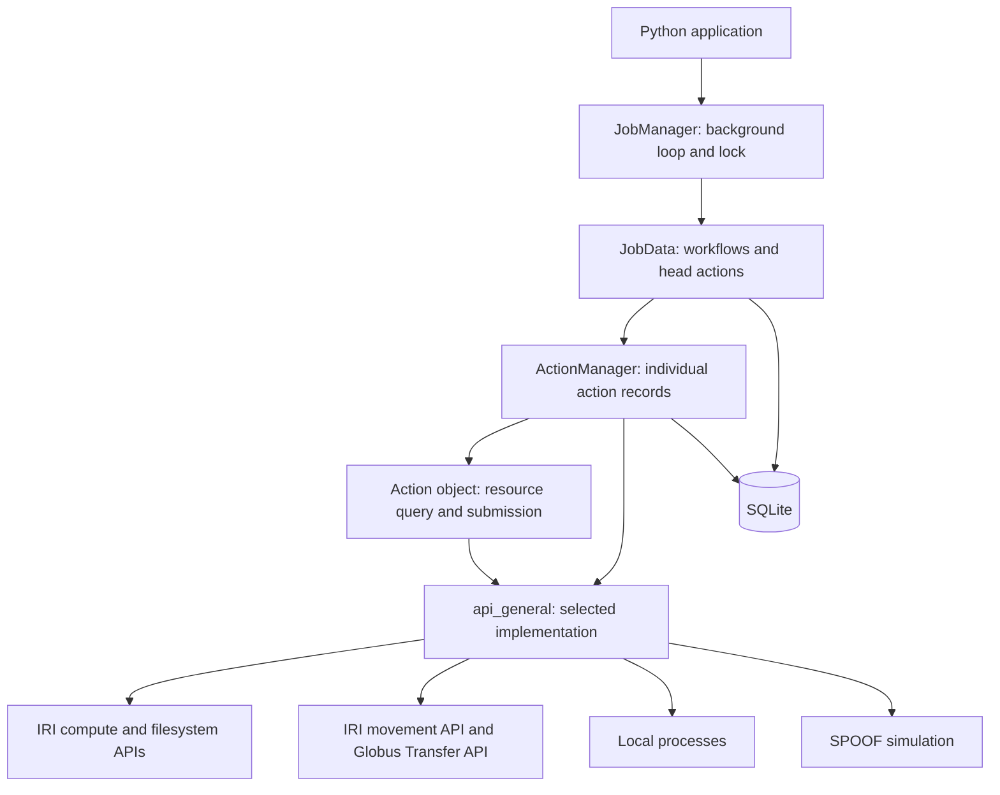

# Architecture

[Documentation home](../README.md#documentation)

## What the library manages

A workflow is a nonempty, ordered list of compute and transfer actions. Only one
action in a workflow runs at a time. Successful completion permits the next
action to start; failure or cancellation stops progression. Separate workflows
can run concurrently up to the manager's workflow limit.

Actions are Python dataclasses describing operations such as executing a program
or copying a file between collections. Constructing an action performs no API
request. Enqueuing persists it; the manager submits it later.

There is no dependency graph, branching, or automatic rollback of previous
actions. Files created by a successful action remain if a later action fails.

## Layers

| Component | Responsibility |
| --- | --- |
| `JobManager` | Owns a `JobData` instance, progresses it in a background thread, and serializes access through a lock. |
| `JobData` | Persists workflows, selects the current action, allocates action IDs, and advances completed workflows. |
| `ActionManager` | Persists submission/cancellation intent, remote identifiers, status, and retry information for an action. Compute and Globus subclasses implement the remote control operations. |
| Action objects | Describe the requested work. `queryResourceStatus()` supplies an availability signal; `initiateAction()` submits and returns a remote identifier. |
| `api_general` | Selects IRI or SPOOF at import time and supplies shared convenience functions. |
| IRI modules | Implement authentication, provider/resource discovery, compute, filesystem, and transfer requests. Several operations dispatch to local execution when `machine="local"`. |

Low-level filesystem and compute calls can also be used directly through
`api_general`. Direct compute/transfer submissions are not registered as managed
workflow actions: the application must retain their remote IDs and monitor or
cancel them itself.

## Identifiers and persistence

Keep these identifiers distinct:

- **Workflow `job_id`:** the integer returned by `JobData.enqueueJob()`.
- **Action ID:** a separate integer allocated by JobData for each workflow step.
- **Remote API key:** the provider's compute job ID or Globus task ID, stored in
  the action table's `api_key` column. Here “key” means an identifier, not a token.
- **Remote action name:** `amscjm:<action_id>`, used to recover a submitted action
  if the process stops before saving its remote ID.

The manager database contains `jobs`, `action_ids`, `computes`, and `transfers`.
Workflow descriptions and action details are serialized with Python `pickle`.
Use a persistent filename for restart recovery; `filename=None` uses memory.
Only open databases from trusted sources, and retain compatible action classes
and their import paths when reopening one.

Submission intent is committed before the remote request. On recovery, the
manager searches by the durable name before submitting again. This reduces
duplicate work but depends on the remote service's discovery behavior; SQLite
and a remote service do not share a transaction.

See [operations](operations.md) for exact status and retry behavior.
