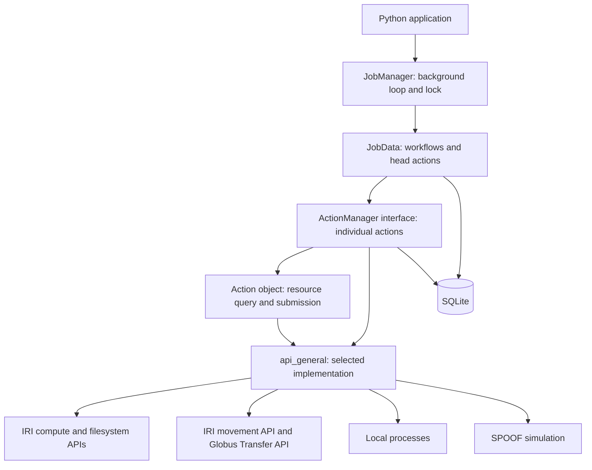

# Architecture

[Documentation home](../README.md#documentation)

## What the library manages

A workflow is a nonempty, ordered list of compute and transfer actions. Only one
action in a workflow runs at a time. Successful completion permits the next
action to start; failure or cancellation stops progression. Separate workflows
can run concurrently up to the manager's workflow limit.

Actions are Python dataclasses describing operations such as executing a program
or copying a file between collections. Constructing an action performs no API
request. Enqueuing persists it; the manager submits it later.

There is no dependency graph, branching, or automatic rollback of previous
actions. Files created by a successful action remain if a later action fails.

## Layers

| Component | Responsibility |
| --- | --- |
| `JobManager` | Owns a `JobData` instance, progresses it in a background thread, and serializes access through a lock. |
| `JobData` | Persists workflows, selects the current action, allocates action IDs, and advances completed workflows. |
| `ActionManager` | Abstract interface plus shared worker lifecycle handling. Does not prescribe storage or polling policy. |
| `AsyncActionManager` | Implements action persistence and its supervision loop for submission/cancellation recovery, remote identifiers, polling, and retries. Compute and Globus subclasses supply the remote control operations. |
| `APIActions` | Runs each ordered API sequence directly on its worker, using its own table and a checkpoint for the next unfinished operation. Interrupted operations must be replay-safe. |
| Action objects | Describe the requested work. `queryResourceStatus()` supplies an availability signal; `initiateAction()` submits and returns a remote identifier. |
| `api_general` | Selects IRI or SPOOF at import time and supplies shared convenience functions. |
| IRI modules | Implement authentication, provider/resource discovery, compute, filesystem, and transfer requests. Several operations dispatch to local execution when `machine="local"`. |

Low-level filesystem and compute calls can also be used directly through
`api_general`. Direct compute/transfer submissions are not registered as managed
workflow actions: the application must retain their remote IDs and monitor or
cancel them itself.

## Identifiers and persistence

Keep these identifiers distinct:

- **Workflow `job_id`:** the integer returned by `JobData.enqueueJob()`.
- **Action ID:** the `actions` table's integer primary key, assigned by JobData
  to every workflow step when the workflow is enqueued.
- **Remote API key:** the provider's compute job ID or Globus task ID, stored in
  the action table's `api_key` column. Here “key” means an identifier, not a token.
- **Remote action name:** `amscjm_<action_id>`, used to recover a submitted action
  if the process stops before saving its remote ID.

The manager database contains `jobs`, `actions`, `computes`, `transfers`, and
`api_actions`. Each queued stage has an `actions` row with its workflow ID,
zero-based stage index, concrete type, category, recorded status, and a pickled
action definition. There is no workflow-level BLOB or separate ID allocator.
`jobs` retains workflow metadata, the current stage, and a persisted
`workflow_status`: PENDING, ACTIVE, COMPLETED, FAILED, CANCELING, or CANCELED.
ACTIVE includes submission, provider-held work, and intermediate action
completion; SCHEDULING and PROVIDER_HELD are only action statuses. CANCELING
records workflow-wide cancellation intent. Globus INACTIVE and IRI compute held
map to PROVIDER_HELD, preserving polling and cancellation of accepted work.
A read-only `workflow_heads` view derives head metadata and action status.

Action managers own their execution records. JobData copies their recorded
statuses into `actions`, retaining completed stages after the head advances.
The action projection and corresponding overall workflow status update commit
together. Advancing past the final stage records workflow completion, while
cancellation remains authoritative over late execution-status results.
`jobStatus()` reads the persisted workflow status, and workflow listing filters
that column directly. Head-action status remains independent: canceling a chain
does not turn an already successful producer into a canceled action.
`jobState` and `listWorkflows` return workflow/head metadata without loading or
returning serialized action definitions.

Action definitions also accept optional keyword-only `producer_key` and
`depends_on` fields. The latter is a string key or a nested infix list, for
example `["prepared", "AND", ["solver_a", "OR", "solver_b"]]`. Nonempty lists
alternate operands with uppercase AND/OR operators. Nested lists act as
parentheses; AND has its normal precedence over OR. These fields are stored as
producer text and dependency JSON in the action rows, but **dependency enforcement
is not implemented yet**: these fields currently have no effect on execution
or cancellation.
`evaluateDependencies(condition, completed)` evaluates an expression using a
caller-supplied completion lookup. It validates the structure and translates
only Boolean literals, operators, and parentheses to Python for evaluation;
dependency-key text is never inserted into the generated expression.

This schema requires a fresh database; older workflow schemas are not migrated.
Use a persistent filename for restart recovery; `filename=None` uses memory.
Only open databases from trusted sources, and retain compatible action classes
and their import paths when reopening one.

Submission intent is committed before the remote request. On recovery, the
manager searches by the durable name before submitting again. This reduces
duplicate work but depends on the remote service's discovery behavior; SQLite
and a remote service do not share a transaction.

See [operations](operations.md) for exact status and retry behavior.
