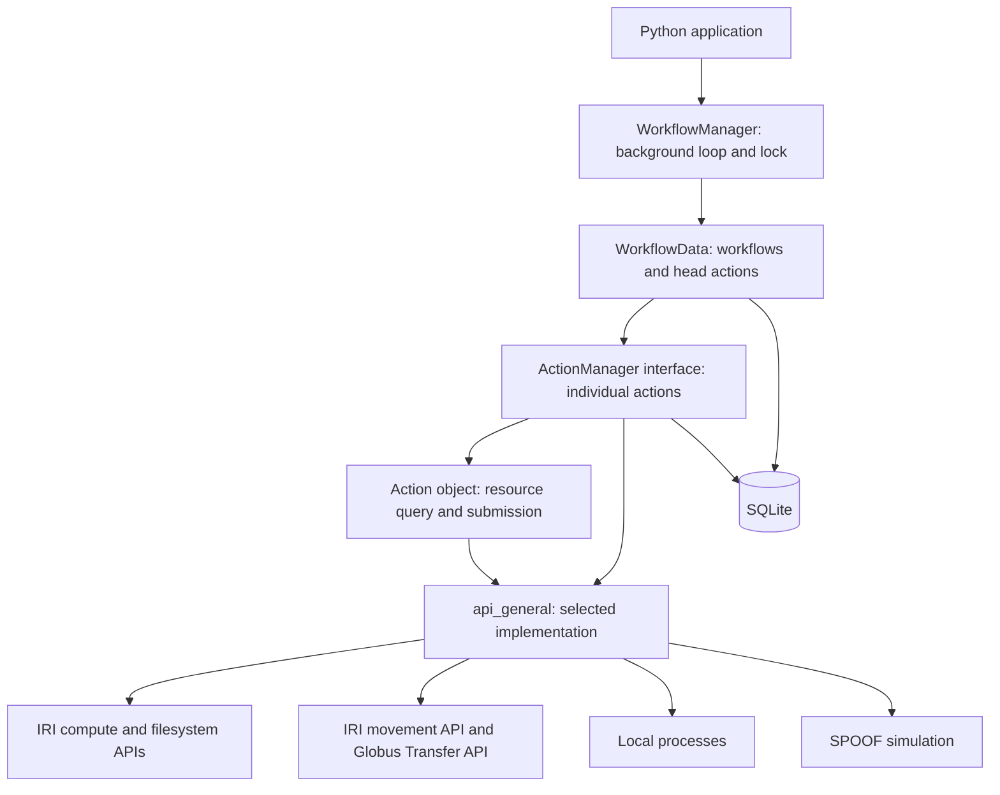

# Architecture

[Documentation home](../README.md#documentation)

## What the library manages

A workflow is a nonempty, ordered list of API, compute, and transfer actions. Only one
action in a workflow runs at a time. Successful completion permits the next
action to start; failure or cancellation stops progression. Separate workflows
can run concurrently up to the manager's workflow limit.

Actions are Python dataclasses describing operations such as executing a program
or copying a file between collections. Constructing an action performs no API
request. Enqueuing persists it; the manager submits it later.

Producer keys and dependency conditions connect separate sequential workflows
into parallel branches and joins. There is no automatic rollback of previous
actions. Files created by a successful action remain if a later action fails.

## Layers

| Component | Responsibility |
| --- | --- |
| `WorkflowManager` | Owns a `WorkflowData` instance, progresses it in a background thread, and serializes access through a lock. |
| `WorkflowData` | Persists workflows, selects the current action, allocates action IDs, and advances completed workflows. |
| `ActionManager` | Abstract interface plus shared worker lifecycle handling. Does not prescribe storage or polling policy. |
| `AsyncActionManager` | Implements action persistence and its supervision loop for submission/cancellation recovery, remote identifiers, polling, and retries. Compute and Globus subclasses supply the remote control operations. |
| `APIActions` | Runs each ordered API sequence directly on its worker, using its own table and a checkpoint for the next unfinished operation. Interrupted operations must be replay-safe. |
| Action objects | Describe the requested work. `queryResourceStatus()` supplies an availability signal; `initiateAction()` submits and returns a remote identifier. |
| `api_general` | Selects IRI or SPOOF at import time and supplies shared convenience functions. |
| IRI modules | Implement authentication, provider/resource discovery, compute, filesystem, and transfer requests. Several operations dispatch to local execution when `machine="local"`. |

Low-level filesystem and compute calls can also be used directly through
`api_general`. Direct compute/transfer submissions are not registered as managed
workflow actions: the application must retain their remote IDs and monitor or
cancel them itself.

## Identifiers and persistence

Keep these identifiers distinct:

- **Workflow `workflow_id`:** the integer returned by `WorkflowData.enqueueWorkflow()`.
- **Workflow group `workflow_group`:** optional, nonunique metadata supplied at
  submission; it is separate from the unique `submission_key` used for retry safety.
- **Action ID:** the `actions` table's integer primary key, assigned by WorkflowData
  to every workflow step when the workflow is enqueued.
- **Remote API key:** the provider's compute job ID or Globus task ID, stored in
  the action table's `api_key` column. Here “key” means an identifier, not a token.
- **Remote action name:** `amscjm_<action_id>`, used to recover a submitted action
  if the process stops before saving its remote ID.

The manager database contains `workflows`, `actions`, `computes`, `transfers`, and
`api_actions`. Each queued stage has an `actions` row with its workflow ID,
zero-based stage index, concrete type, category, recorded status, and a pickled
action definition. There is no workflow-level BLOB or separate ID allocator.
`workflows` retains workflow metadata, the current stage, and a persisted
`workflow_status`: PENDING, ACTIVE, COMPLETED, FAILED, CANCELING, or CANCELED.
ACTIVE includes submission, provider-held work, and intermediate action
completion; SCHEDULING and PROVIDER_HELD are only action statuses. CANCELING
records workflow-wide cancellation intent; executing heads are always canceled.
Globus INACTIVE and IRI compute held
map to PROVIDER_HELD, preserving polling and cancellation of accepted work.
A read-only `workflow_heads` view derives head metadata and action status.

Workflow terminology applies to the Python interface, persisted records, and
MCP fields. Individual compute jobs retain provider-oriented names such as
`executeJob` and `cancelJob`; their provider IDs are distinct from workflow IDs.
The package name and `AMSC_JOB_MANAGER_API_IMPL` environment variable are unchanged.
This alpha schema does not migrate databases using the previous workflow field
names; create a new workflow database for this version.

Two additional read-only views centralize status rules:

- `action_status_groups(group_name, action_status)` defines LIVE (ACTIVE and
  PROVIDER_HELD) and EXECUTING (SCHEDULING plus LIVE).
- `action_status_mapping(action_status, workflow_status)` maps each head status
  to its corresponding overall status. EXECUTING and COMPLETED map to ACTIVE;
  other statuses map to themselves.

The views are generated from the shared `ActionStatus`/`ActionStatusGroup`
definitions used by Python checks. Polling and `getLiveActions()` select LIVE
members; execution supervision selects EXECUTING. Waiting for completion also
includes CANCELING explicitly, rather than defining another group.

Action managers own their execution records. WorkflowData copies their recorded
statuses into `actions`, retaining completed stages after the head advances.
The action projection and corresponding overall workflow status update commit
together. Advancing past the final stage records workflow completion, while
cancellation remains authoritative over late execution-status results.
An externally canceled head first places its workflow in CANCELING so that
reconciliation can finish cancellation of its remaining queued stages.
`workflowStatus()` reads the persisted workflow status, and workflow listing filters
that column directly. Head-action status remains independent: canceling a chain
does not turn an already successful producer into a canceled action.
`workflowState` and `listWorkflows` return workflow/head metadata without loading or
returning serialized action definitions.

Action definitions also accept optional keyword-only `producer_key` and
`depends_on` fields. The latter is a string key or a nested infix list, for
example `["prepared", "AND", ["solver_a", "OR", "solver_b"]]`. Nonempty lists
alternate operands with uppercase AND/OR operators. Nested lists act as
parentheses; AND has its normal precedence over OR. These fields are stored as
producer text and dependency JSON in the action rows. WorkflowData checks keys against
earlier submissions and earlier stages of the same workflow before inserting each
action. Unknown references reject the entire submission; no partial chain or
submission key is retained. Dependency checks require no action-manager records.

An action starts only when its expression is satisfied by successful producers
in the database. Any successful producer satisfies a repeated key. Unready heads
and workflows remain PENDING without workers or capacity use. Automatic scheduling
considers eligibility before applying the available-slot limit. Waiting between
stages retains completed history and resumes the same pending stage.

Cancellation computes `depends_on_canceled_action`: whether a condition requires
unfinished work ruled out by cancellation. Each key is checked for successful or
noncanceled producers, the AND/OR expression is evaluated, and the whole result
is negated. Merely referencing a canceled producer is insufficient when another
producer or OR branch remains. Failed producers alone leave this flag false and
consumers pending; they do not trigger a cancellation cascade. Canceling the last
noncanceled producer cancels workflows requiring its key, including those with a
dependency in a later stage. The complete cascade is recorded atomically
before remote cancellation. Intent recording changes only workflow records;
reconciliation handles pending heads locally, preserves terminal action history,
and delegates executing heads to their action managers. Constructor recovery calls
the same `WorkflowData.performPendingCancellations()` method before restoring ordinary
ACTIVE execution workers.
The cancellation check follows prerequisite chains, so a waiting action cannot count its
own future output or a circular fallback as an alternative after a producer is
canceled. Ordinary passes with no canceled producers skip this graph scan.
No dependency registry, reverse-reference table, or waiting threads are needed.

`evaluateDependencies(condition, completed)` evaluates an expression using a
caller-supplied completion lookup. It validates the structure and translates
only Boolean literals, operators, and parentheses to Python for evaluation;
dependency-key text is never inserted into the generated expression.

This schema requires a fresh database; older workflow schemas are not migrated.
Use a persistent filename for restart recovery; `filename=None` uses memory.
Only open databases from trusted sources, and retain compatible action classes
and their import paths when reopening one.

Submission intent is committed before the remote request. On recovery, the
manager searches by the durable name before submitting again. This reduces
duplicate work but depends on the remote service's discovery behavior; SQLite
and a remote service do not share a transaction.

See [operations](operations.md) for exact status and retry behavior.
